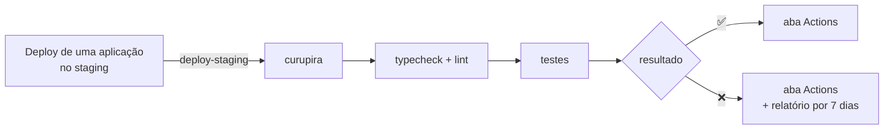

<div align="center">


# curupira

**Testes end-to-end da Emcash**

*O curupira guarda a floresta e tem os pés virados para trás.*<br>
*Estes testes guardam os produtos e olham para trás: pegam o que funcionava e parou de funcionar.*

[](https://github.com/GabrielBruno7/curupira/actions/workflows/e2e.yml)


</div>

---

## 🌳 O que é

Testes que usam os produtos da Emcash **como um usuário usaria**: pelo navegador nos portais, e pelas mesmas chamadas de API que o app faz. Eles rodam depois de cada deploy no staging e avisam quando algo que funcionava quebrou.

> [!IMPORTANT]
> **Nunca aponte os testes para um ambiente com dados reais:** eles criam usuários. E o staging envia **SMS e e-mails de verdade** (veja [docs/wallet.md](docs/wallet.md)).

## 🧪 O que já é testado

| | Teste | O que cobre |
|---|---|---|
| 🔐 | [`tests/app/login.spec.ts`](tests/app/login.spec.ts) | Login do app com a senha certa (e o token funciona) e com a senha errada |
| 📝 | [`tests/app/registration.spec.ts`](tests/app/registration.spec.ts) | Cadastro simplificado: SMS → e-mail → cadastro → primeiro login → informações adicionais. E o cadastro sem SMS confirmado é recusado |
| 💰 | [`tests/consignado/create-proposal.spec.ts`](tests/consignado/create-proposal.spec.ts) | Proposta de consignado criada na wallet (fingindo ser o Hermes): tomador, proposta, cálculo e parcelas no banco. E a segunda proposta do mesmo CPF e o número de parcelas fora do limite são recusados |

## 🚀 Rodando

Só precisa de **Docker**.

```bash
./curupira start
```

Na primeira vez ele cria o `.env` (com os valores da wallet local) e monta a imagem dos testes, o que leva alguns minutos. Depois mostra se os serviços estão no ar e um menu para escolher o que rodar, com cada passo na tela e um resumo no fim.

| Comando | O que faz |
|---|---|
| `curupira start` | Menu no terminal: rodar todos os testes, uma pasta, um arquivo ou um teste só, check, ou abrir o relatório (`q` volta um nível) |
| `curupira start ui` | Abre o **UI mode** do Playwright no navegador (http://localhost:8090): roda com um clique e mostra cada passo, com as requisições e respostas |
| `curupira run [arquivo]` | Roda direto no terminal: tudo, ou só os arquivos indicados |
| `curupira check` | `typecheck` + `lint`, como o CI faz primeiro |
| `curupira report` | Abre o relatório da última execução (http://localhost:9323) |
| `curupira install` | Para digitar `curupira` em vez de `./curupira` |

Os serviços **não** sobem aqui: eles já precisam estar no ar. Para subir a wallet na sua máquina, veja [docs/wallet.md](docs/wallet.md#running-it-locally). O script só chama o `docker compose`; os comandos completos estão no [CLAUDE.md](CLAUDE.md#commands).

> [!TIP]
> **Falhou?** Comece por `test-results/<teste>/error-context.md`.

### Variáveis (`.env`)

| Variável | O que é |
|---|---|
| `WALLET_API_URL` | Endereço da API da wallet |
| `WALLET_DB_URL` | Banco da wallet, para ler os códigos de SMS e e-mail |
| `WALLET_USERNAME` · `WALLET_PASSWORD` · `WALLET_DEVICE_ID` | Um usuário que já existe, com um dispositivo cadastrado |

O `.env.example` já vem com os valores da wallet local. Um serviço rodando na sua máquina é `host.docker.internal`, não `localhost`. Se faltar uma variável, só os testes que dependem dela falham, com uma mensagem dizendo qual é.

## ✍️ Vai escrever um teste?

> [!TIP]
> **Com o Claude Code:** rode `/write-e2e-test` e diga qual jornada quer testar. Ele pesquisa o fluxo no código dos serviços enquanto te faz perguntas, combina o cenário com você e só então escreve o teste, roda e faz ele falhar de propósito.

Na mão, siga o [**passo a passo**](WRITING-A-TEST.md) (em inglês, como todo o resto do código). Em resumo:

1. Escreva o cenário em palavras e faça na mão primeiro.
2. Copie um modelo de [`examples/`](examples/) para `tests/<produto>/`.
3. Escreva os passos como `test.step`, depois preencha.
4. **Faça o teste falhar de propósito.** Se ele não falha, não testa nada.

## 🗺️ Onde está cada coisa

| | Onde | O quê |
|---|---|---|
| 📘 | [WRITING-A-TEST.md](WRITING-A-TEST.md) | Como escrever um teste, e as regras |
| 🔎 | [docs/](docs/) | O que sabemos de cada serviço: endpoints, regras, limites, bugs ([wallet](docs/wallet.md)) |
| 🧭 | [PLAN.md](PLAN.md) | A estratégia: decisões, pré-requisitos, pendências |
| 🧪 | `tests/<produto>/` | Os testes |
| 🧰 | `support/` | Código compartilhado: `env()`, `newUser()`, a fixture `walletDb` |
| 🔥 | `curupira`, `cli/` | O comando `curupira`: o menu e a saída bonita dos testes |
| 📄 | `examples/` | Modelos de teste e o passo de CI para os repos das aplicações (não rodam) |

## 🔄 No CI



O workflow roda depois de cada deploy no staging (o repo da aplicação envia `deploy-staging`) ou na mão, pelo botão **Run workflow**. Ele **não bloqueia** nenhum deploy.

> [!WARNING]
> **Ainda não está pronto para o staging.** Falta SMS de teste, runner interno, usuário só de leitura no banco e mais alguns itens: veja a lista em [PLAN.md](PLAN.md#before-the-first-staging-run).

<details>
<summary><b>Configurar o CI</b></summary>

<br>

Em **Settings → Secrets and variables → Actions**:

- **Variables:** `WALLET_API_URL`, `WALLET_USERNAME`, `WALLET_DEVICE_ID`
- **Secrets:** `WALLET_PASSWORD`, `WALLET_DB_URL`

**Rodar todo dia às 6h:** adicione em `on:` no workflow:

```yaml
  schedule:
    - cron: '0 9 * * *'
```

**Nos repos das aplicações:** adicione o passo de [`examples/trigger-e2e.yml`](examples/trigger-e2e.yml) logo depois do deploy no staging, com o secret `E2E_DISPATCH_TOKEN` (um GitHub App ou token com "Contents: read and write" neste repo). Ele só avisa este repo; o deploy não espera os testes.

</details>

<details>
<summary><b>Configuração do Playwright</b></summary>

<br>

- **Sem `baseURL`:** uma jornada passa por vários serviços, então cada teste monta os endereços a partir das variáveis.
- **Dois projetos:** `api` (testes com a tag `@api`, sem navegador, `User-Agent: curupira-e2e`) e `web` (Chrome).
- **Idioma e fuso fixos** (`pt-BR`, `America/Sao_Paulo`): o container vem em inglês/UTC.
- **No CI:** 1 nova tentativa (o teste aparece como *flaky*), 2 workers, e um `test.only` esquecido falha a execução.
- **Versão do Playwright:** a mesma no `package.json`, no `Dockerfile` e no workflow. Atualize as três juntas.
- **Sem Docker:** `nvm use && npm install && npx playwright install --with-deps chromium && npm test`.

</details>
